<h1 align="center">NTNXVision</h1>

<p align="center"><strong>RVTools for Nutanix on Steroids</strong></p>

<p align="center">
Inventory and architecture documentation for Nutanix Prism Central and its clusters.<br>
One read-only collection gives you an Excel inventory, a PDF report, a Word Architecture Design
Document and editable design diagrams. Windows and macOS.
</p>

<p align="center">
  
  
  <a href="LICENSE"></a>
</p>

<picture>
  <source media="(prefers-color-scheme: dark)" srcset=".github/readme/overview-dark.png">
  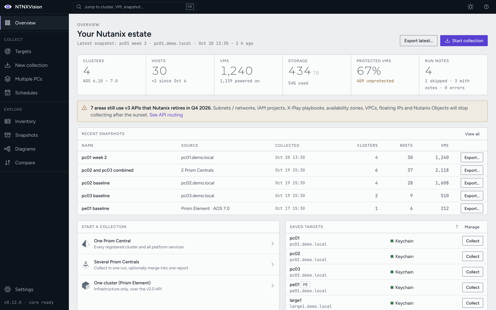
</picture>

<sub>Every screenshot on this page comes from the real app in demo mode, against a synthetic estate (`pc01.demo.local` and friends). No customer or lab data.</sub>

## Contents

- [Top features](#top-features)
- [More features](#more-features)
- [Install](#install)
- [Try it without a lab (demo mode)](#try-it-without-a-lab-demo-mode)
- [Build from source](#build-from-source)
- [How it works](#how-it-works)
- [Safety and security](#safety-and-security)
- [Contributing and versioning](#contributing-and-versioning)
- [License](#license)

## Top features

### 1. One-click collection of the whole estate

Point NTNXVision at a Prism Central, a single Prism Element cluster, or several Prism Centrals
at once, and it inventories everything: clusters, hosts, VMs, storage, networking, data
protection and DR, Flow security and VPCs, Files, Objects, volume groups, IAM, X-Play, NCM,
licensing, LCM and NDB databases (through the Era API).

- **Read-only.** Collectors only issue GET and list calls. A built-in guard refuses every write.
- **Version-aware.** Each area uses the v4 API where the Prism Central version supports it, falls
  back to v3, and uses v2.0 for cluster-local data. The Overview warns which areas still depend
  on v3 before Nutanix retires it in Q4 2026.
- **Scoped and cancellable.** Pick clusters and areas, watch live progress per area, and cancel
  at any time (a cancelled run saves nothing). Several Prism Centrals collect in parallel and can
  merge into one combined report.

<p>
  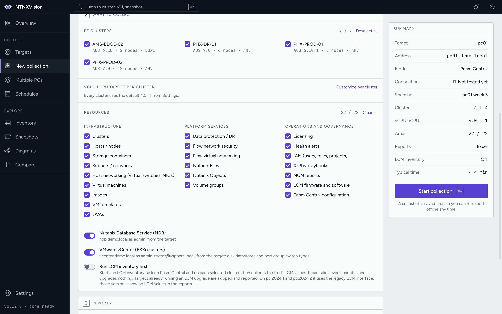
  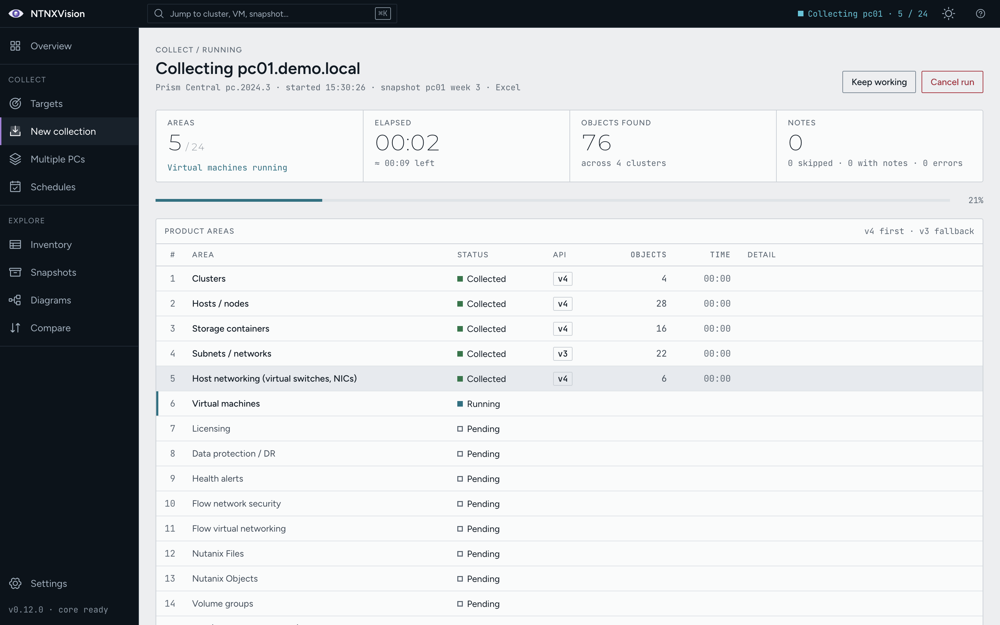
</p>

### 2. Word Architecture Design Document, PDF and Excel

Every collection becomes a snapshot that exports, now or later and fully offline, to:

- a **Word Architecture Design Document** (built-in template or your own `.dotx`, with
  prepared-for and author on the cover),
- a **PDF report** with the same chapters, figures and tables,
- an **Excel workbook** with one sheet per object type (Cluster column first everywhere).

Choose which chapters the reports include and in what order, per export or as a saved default.
The Export dialog shows exactly **what lands in the export folder** before you click, with file
names, sizes and the diagram files. The same snapshot always exports byte-identical files.

<p>
  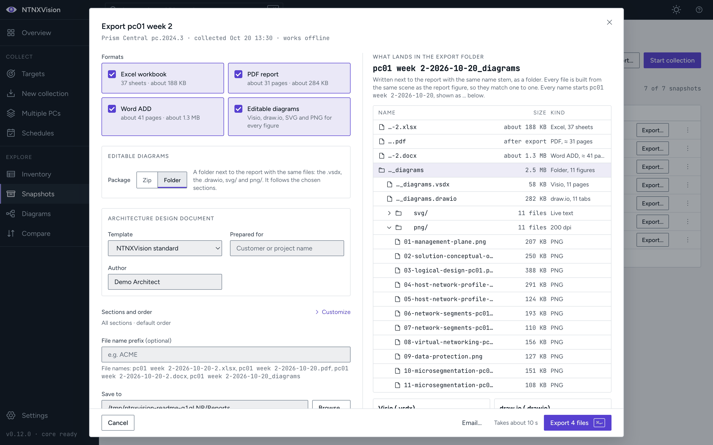
  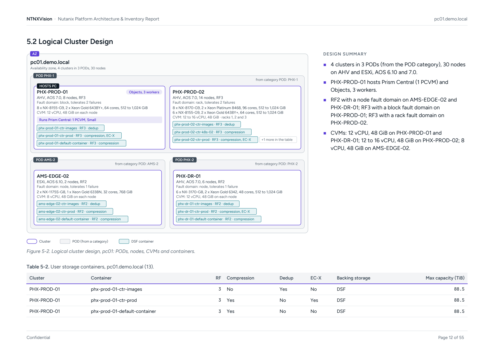
</p>

### 3. Architecture design diagrams you can edit

The reports draw the architecture for you, from collected data: Solution Conceptual Overview,
Logical Cluster Design, Management Plane Design, Host Network Configuration, Disaster Recovery
Design, Network Segment Design, Flow Virtual Networking Design and Microsegmentation Design.
Large estates split into parts, each with a design summary and the tables behind it.

The **Diagrams** page lets you refine any figure before it goes into a report: rename, reorder
by dragging cards to slots, add clusters, Prism Centrals, storage arrays, switches and notes, and
draw **connectors** between elements (label, sides, lane, arrowheads). User-added items are drawn
dashed amber, never appear in the tables, and are disclosed in the figure's summary. Edits carry
forward to the next collection of the same estate when they still apply.

Every figure also exports as **editable Visio (`.vsdx`), draw.io, SVG and PNG** files, with real
shapes and glued connectors, from the Export dialog or straight from the Diagrams page.

<p>
  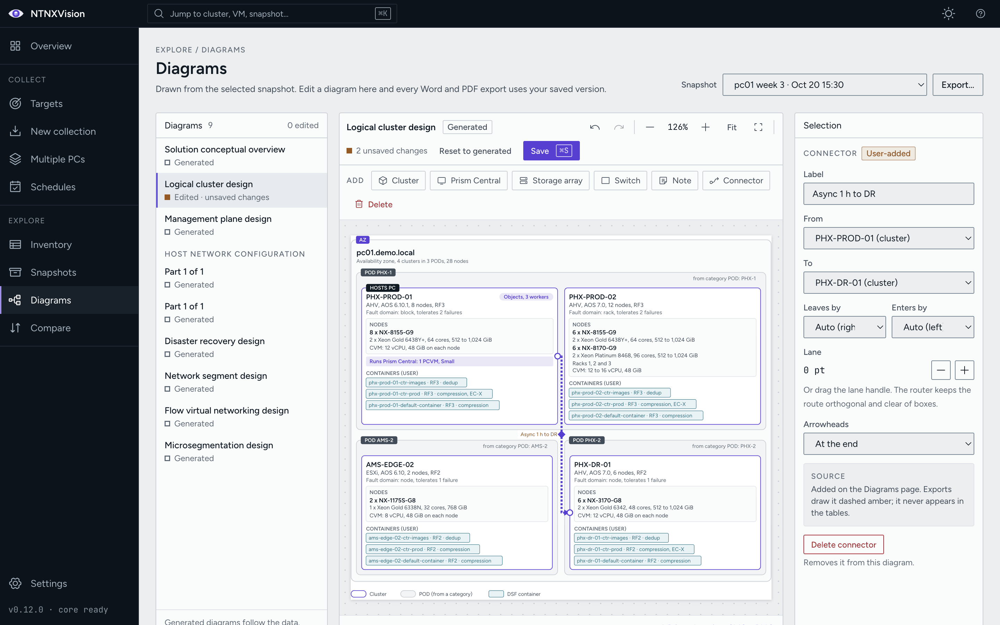
  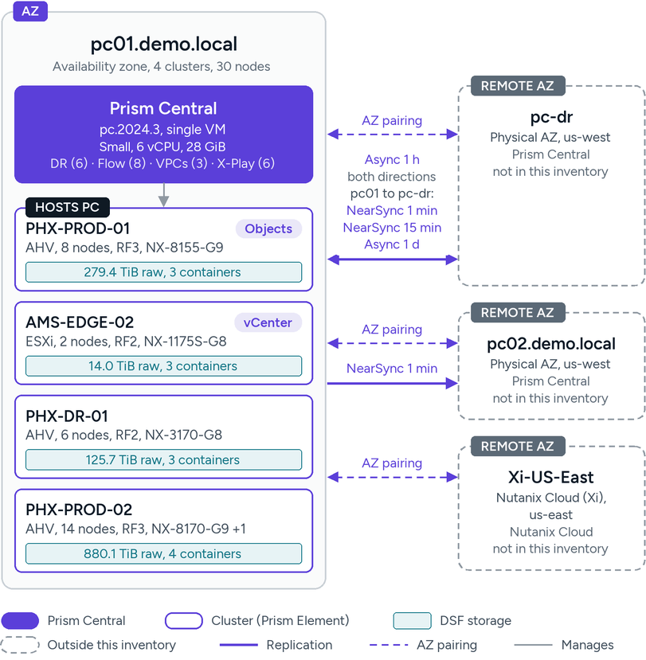
</p>

### 4. Inventory explorer, Compare and capacity

- **Inventory**: browse every object type in a snapshot, filter, sort, pick columns, open the
  details of any object and export the current view. ⌘K / Ctrl+K jumps to any cluster, VM or
  snapshot.
- **Compare**: diff two snapshots of the same estate (drift): what was added, removed and
  changed, field by field, exportable to Excel or PDF.
- **Capacity**: per-cluster CPU and storage capacity with oversubscription ratios (full and N-1)
  against a vCPU:pCPU target you can set per cluster.

<p>
  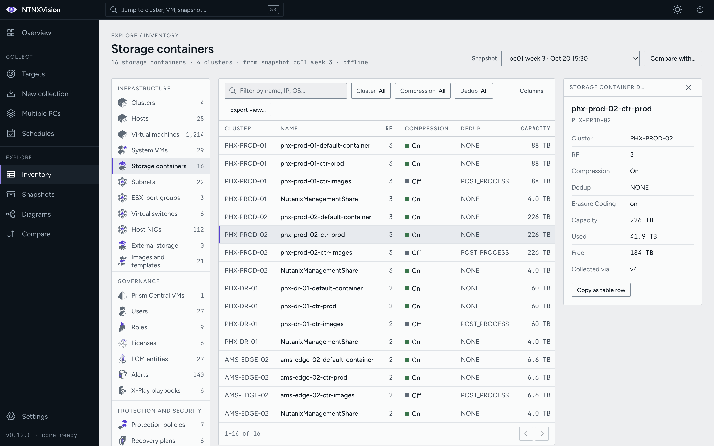
  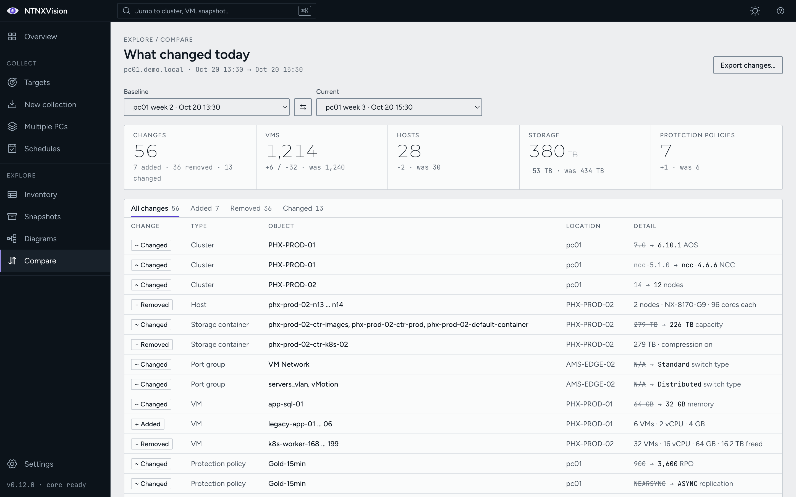
</p>
<p>
  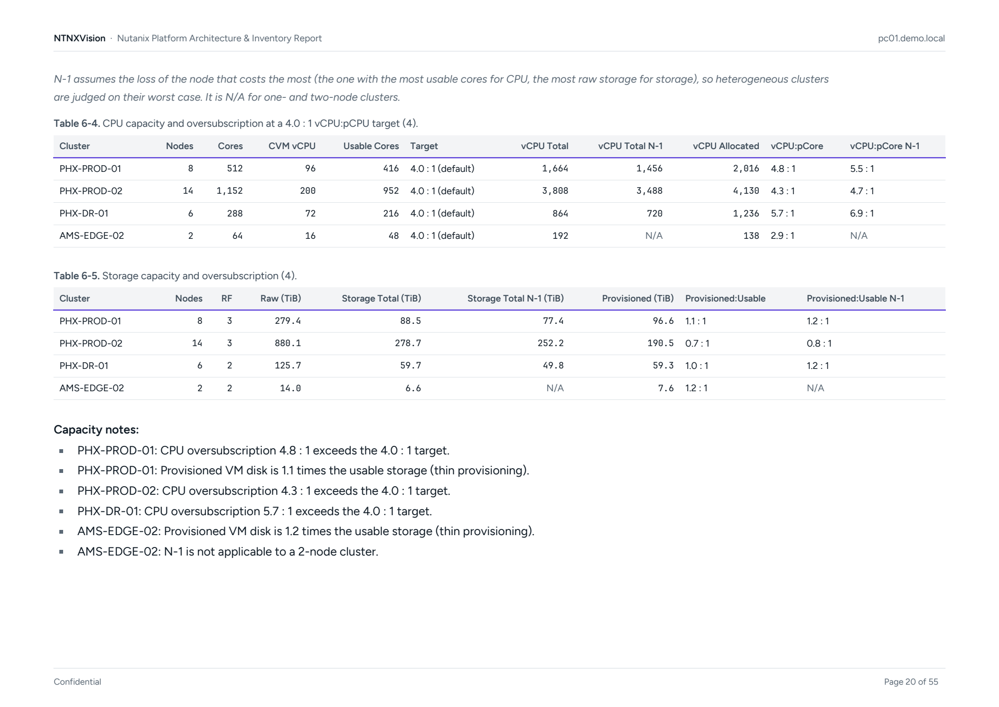
</p>

### 5. Schedules with email delivery

Collect fresh on a schedule (daily, weekly or monthly, in local time) and email the reports to
several recipients over your own SMTP server (None, STARTTLS or SSL/TLS). A failed run sends a
short notice that says where and why. While a schedule is enabled, NTNXVision keeps running in
the Windows system tray or the macOS menu bar, and missed runs catch up once at the next launch.
You can also email any report on demand.

<p>
  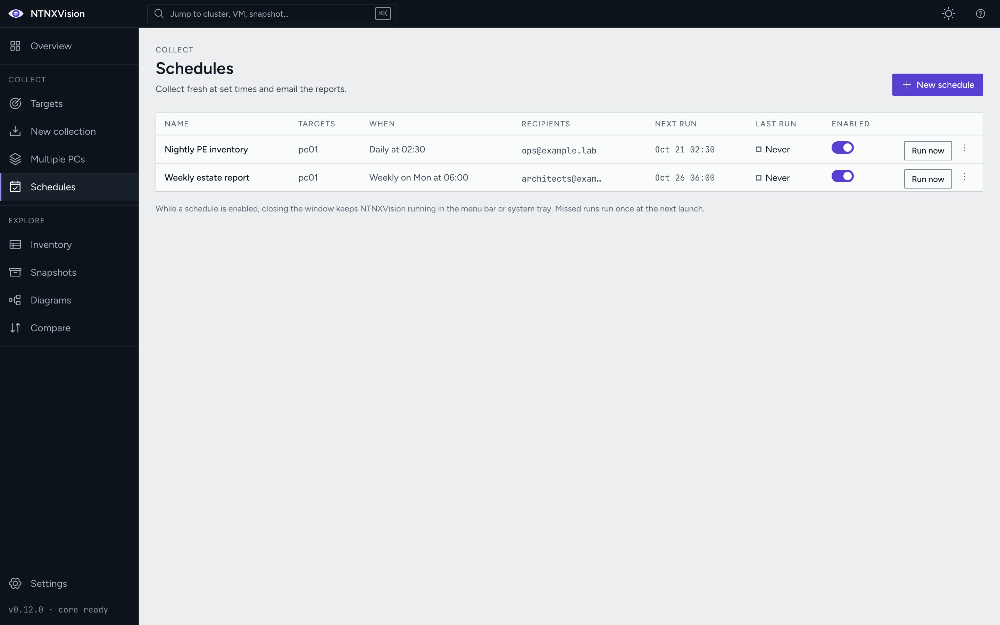
  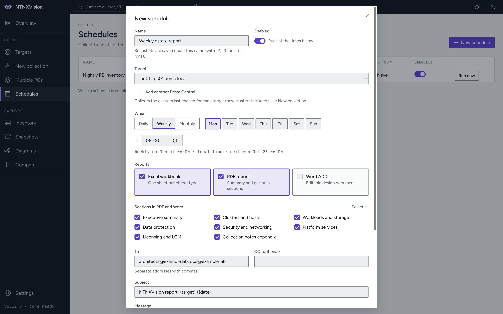
</p>

## More features

- **Demo mode**: the whole app against a synthetic estate, no lab needed (see below).
- **Saved targets**: Prism Central, Prism Element, NDB and vCenter endpoints with their
  credentials in the OS keychain, a connection test that explains failures, and trust on first
  use for self-signed certificates.
- **Cluster scope**: collect only the clusters you pick; snapshots get a required, readable name.
- **ESXi completeness**: ESXi VMs missing from v4 are read through Prism Element (v2.0), and an
  optional vCenter connection adds datastores, port groups and guest details.
- **LCM inventory (opt-in)**: run a real LCM inventory on Prism Central and each cluster before
  collecting, so firmware and software versions are current. Off by default, never from schedules.
- **Offline snapshots**: re-export any time without a connection; move snapshots between machines
  as portable `.ntnxsnap` files (double-click to import).
- **Results page**: per-area outcome, API used and collection notes for every run.
- **File name prefix** for reports, and report names that never overwrite an earlier export.
- **Tamper checks**: schedules and email settings are protected by an HMAC whose key lives in
  the keychain; an outside edit disables them until you review and save.
- **Light, dark and high-contrast themes**, keyboard shortcuts and a command palette.
- **Windows tray / macOS menu bar**, notifications and Start at login for scheduled runs.

<p>
  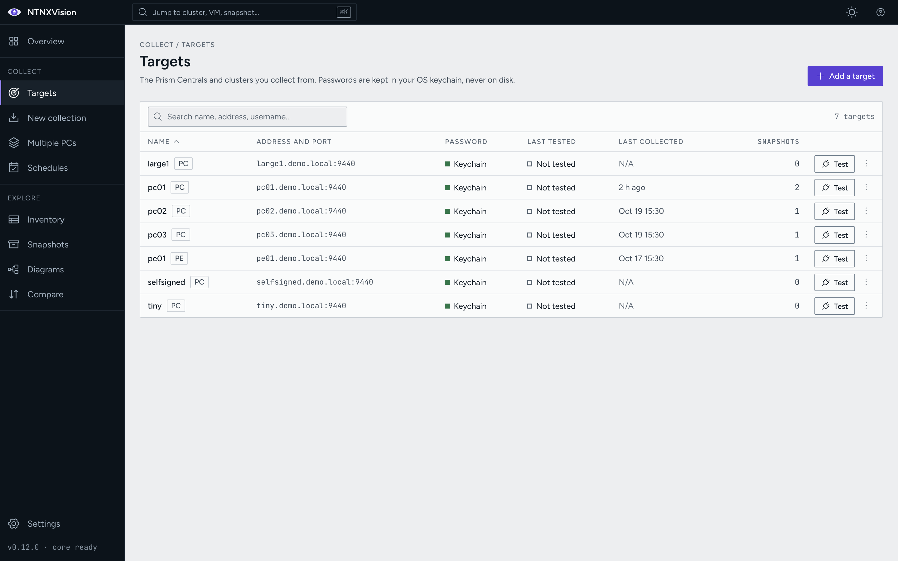
  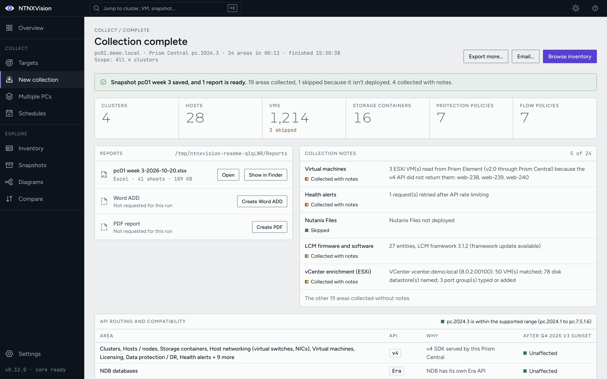
</p>

## Install

### Download

Installers are built by the [Release workflow](.github/workflows/release.yml) on GitHub
Actions. A version tag (`v*`) creates a **draft** GitHub Release with every installer, a
`SHA256SUMS` file and a build-provenance attestation; the maintainer publishes it on the
[Releases](../../releases) page. Pull requests into `main` and manual runs build the same
installers as workflow artifacts (`NTNXVision-windows-msi`, `NTNXVision-macos-arm64`,
`NTNXVision-macos-x64`). Check a download against `SHA256SUMS` with `shasum -a 256 <file>`
(macOS) or `Get-FileHash <file>` (Windows).

| Platform | File | Notes |
|---|---|---|
| Windows 10 / 11, x64 | `NTNXVision-<version>-win-x64.msi` | Per-machine install, needs admin. Silent: `msiexec /i NTNXVision-<version>-win-x64.msi /qn` |
| Windows 11 on ARM | `NTNXVision-<version>-win-arm64.msi` | arm64 app; the bundled Python core runs under x64 emulation |
| macOS 11 or later, Apple silicon | `NTNXVision-<version>-mac-arm64.dmg` (or `.zip`) | Drag NTNXVision to Applications |
| macOS 11 or later, Intel | `NTNXVision-<version>-mac-x64.dmg` (or `.zip`) | Drag NTNXVision to Applications |

Upgrades install over the previous version and keep your targets, snapshots and settings.

**Unsigned builds.** Builds made without the maintainer's signing certificates (local builds and
CI artifacts from pull requests or manual runs) are not code-signed: the macOS app is only
ad-hoc signed and not notarized, and the MSI has no Authenticode signature.

- **macOS**: Gatekeeper refuses the first launch, often as "NTNXVision is damaged and can't be
  opened". After copying the app to Applications, clear the download quarantine flag once:
  ```bash
  xattr -cr /Applications/NTNXVision.app
  ```
  Then open it normally. (On older macOS versions, right-click the app and choose **Open** also works.)
- **Windows**: SmartScreen may show "Windows protected your PC". Choose **More info**, then
  **Run anyway**.

### Supported versions

| Product | Supported range |
|---|---|
| Prism Central | pc.2024.1 to pc.7.5.1.6 |
| AOS (Prism Element) | 6.5 to 7.5 |
| NDB | Era API, any version reachable from the target |

Versions outside the range **warn but proceed**: the run shows a non-blocking compatibility
warning and still collects. v4 APIs are used from pc.2024.3 / AOS 7.0 on; older versions
collect through v3 and v2.0.

### Requirements and permissions

- Network access from your computer to Prism Central (and Prism Element, NDB or vCenter if used)
  on HTTPS, port 9440 by default.
- A **read-only** account is enough for collection (a viewer role on Prism Central; NDB and
  vCenter credentials only if you collect them). NTNXVision only reads.
- **The one opt-in write: LCM inventory.** If you switch on "Run LCM inventory first", NTNXVision
  starts an LCM inventory task on Prism Central and each selected cluster. That needs an account
  allowed to run LCM inventory, and it is the only request the read-only guard lets through, only
  while that option is on. It upgrades nothing.
- Outbound SMTP only if you configure email.

## Try it without a lab (demo mode)

Demo mode runs the real collectors, snapshot store and exporters against a mock Nutanix API on
`127.0.0.1` serving a synthetic estate. Your real keychain and snapshots are never touched, and
the title bar says "Demo data".

```bash
# Installed app
open -a NTNXVision --args --demo                     # macOS
"C:\Program Files\NTNXVision\NTNXVision.exe" --demo  # Windows

# From source (after the setup below)
cd app && npm run demo
```

The first demo launch saves seven targets and a backdated snapshot history, so Overview, Compare
and Diagrams have data straight away. Any username works, and any non-empty password except
`wrong` (which shows the sign-in failure). Each collection moves that system one "week" forward,
so a second run gives Compare a believable change list.

| Demo host | What it is |
|---|---|
| `pc01.demo.local` | Prism Central pc.2024.3, 4 clusters, 1,214 VMs, ESXi cluster with vCenter |
| `pc02.demo.local` / `pc03.demo.local` | pc.7.3 with Files; pc.2024.1, which collects through v3 only |
| `pe01.demo.local` | Prism Element, AOS 7.0, 6 hosts |
| `ndb.demo.local` | NDB (Era API) |
| `large1.demo.local` to `large3.demo.local` | about 6,700 VMs each (a 20,000-VM multi-PC estate) |
| `selfsigned.demo.local` / `down.demo.local` | self-signed certificate; unreachable host |

## Build from source

Prerequisites: Python 3.10 to 3.13 (3.13 pinned in `.python-version`) and Node.js 20 or later
(22 pinned in `.nvmrc`).

```bash
git clone https://github.com/achestaro/NTNXVision.git && cd NTNXVision
./scripts/setup-macos.sh --dev                                             # macOS
powershell -ExecutionPolicy Bypass -File .\scripts\setup-windows.ps1 -Dev  # Windows
```

Python core (`core/`):

```bash
cd core
python -m venv .venv && source .venv/bin/activate   # Windows: .venv\Scripts\activate
pip install -e ".[dev]"
pytest                 # tests
ruff check .           # lint
mypy ntnxvision_core   # types
ntnxvision --demo inventory --host pc01.demo.local --username admin --password demo
```

Electron app (`app/`):

```bash
cd app
npm install            # prebuilt native keyring module, no compiler needed
npm run dev            # Vite + Electron with hot reload (npm run dev:demo for demo mode)
npm run lint
npm test               # main-process unit tests
npm run e2e            # drives the real app and Python core end to end in demo mode
npm run readme:shots   # regenerates the images on this page (demo mode)
```

Installers: `./scripts/build-macos.sh` or `.\scripts\build-windows.ps1` run the tests, freeze the
Python core with PyInstaller, smoke-test it, package the app with electron-builder and launch it
once with `--smoke`. See [`build/README.md`](build/README.md) for signing, notarization and CI.

## How it works

```
 Electron + React UI  ──IPC (typed channels)──▶  Electron main process
                                                      │  stdio JSON-RPC
                                                      ▼
                                             Python core (sidecar)
                                     collectors · snapshot store · exporters
                                                      │  HTTPS, read-only
                                                      ▼
                                 Prism Central · Prism Element · NDB · vCenter
```

- **Electron + React** gives the cross-platform point-and-click UI. The renderer is sandboxed
  and only calls the typed channels in `app/src/shared/ipc.ts`.
- **A Python core** runs as a sidecar process and owns data collection (Python is Nutanix's lead
  SDK language) and the export engines (`openpyxl`, `python-docx`, `fpdf2`). The main process
  talks to it over **stdio JSON-RPC**: no network port is opened.
- Collected data lands in one normalized, version-independent model, so v4, v3 and v2.0 payloads
  produce the same snapshot, and every export reads that snapshot offline.
- A broken collector never stops a run: its error becomes a collection note.

| Folder | Contents |
|---|---|
| `app/` | Electron main process, React renderer, IPC contract, e2e and screenshot scripts |
| `core/` | Python core: API clients, collectors, model, snapshot store, exporters, diagrams, demo estate |
| `build/` | Packaging notes (electron-builder, PyInstaller) |
| `scripts/` | Setup, build, version bump and notice scripts |

## Safety and security

- **Read-only collection.** Collectors issue GET and list calls only; a guard refuses any other
  request. The single exception is the opt-in LCM inventory described above.
- **Credentials stay in the OS keychain** (macOS Keychain, Windows Credential Manager), never in a
  file. Saved passwords are bound to their endpoint and never sent back to the UI.
- **Local-only IPC.** The UI talks to the Python core over stdio. The only socket the core ever
  opens is demo mode's mock API, on 127.0.0.1, with synthetic data.
- **Collect only what you ask for.** Area and cluster selection are honoured; a cancelled run
  writes nothing.
- **Hardened app**: sandboxed renderer with a strict Content Security Policy, navigation lock,
  permission deny-all, Electron fuses, certificate pinning when TLS verification is off, and
  spreadsheet formula neutralization in exports.
- On Windows, Credential Manager entries are readable by any process of the same user, so run
  NTNXVision from a dedicated admin account rather than a shared profile.

## Contributing and versioning

Issues and pull requests are welcome. NTNXVision follows [semantic versioning](https://semver.org):
the version lives in `app/package.json`, `core/pyproject.toml` and `ntnxvision_core.__version__`,
set together by `node scripts/bump-version.mjs patch|minor|major`. Every pull request that
changes shipped code bumps it (patch for fixes, minor for features) and adds a section to
[`CHANGELOG.md`](CHANGELOG.md); CI checks both, and runs the tests, lint and installer builds on
pull requests into `main`.

The repository is public: use only example data in tests and screenshots (`example.lab`,
`*.demo.local`, 192.0.2.x, 198.51.100.x), never real hostnames, addresses, usernames or exports.

## License

NTNXVision is released under the [MIT License](LICENSE), © 2026 Alberto Chestaro.

- [`NOTICE`](NOTICE): no warranty, read-only operation and the Nutanix trademark disclaimer.
- [`THIRD_PARTY_NOTICES.md`](THIRD_PARTY_NOTICES.md): every third-party component shipped in the
  installers, with its license text (`cd app && npm run notices`).

Nutanix, Prism, AHV, AOS, Era/NDB, Flow, Files, Objects and related names and logos are
trademarks of Nutanix, Inc. NTNXVision is an independent project and is not affiliated with,
endorsed by, or sponsored by Nutanix, Inc.
